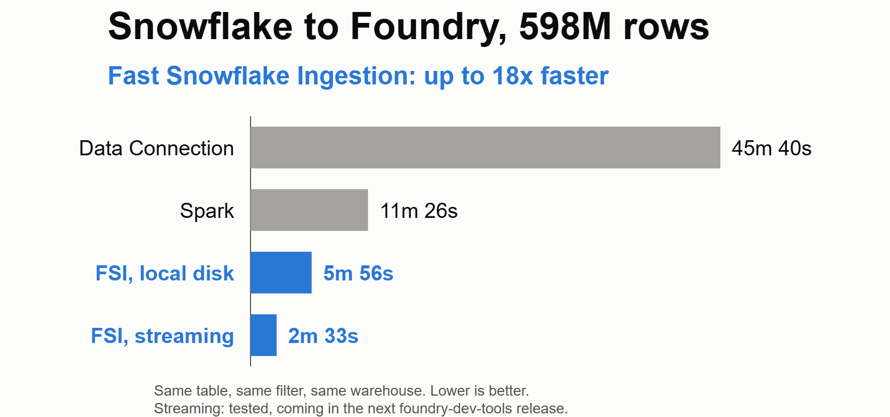
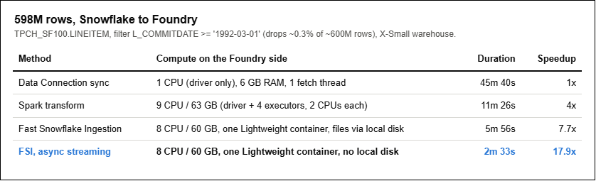
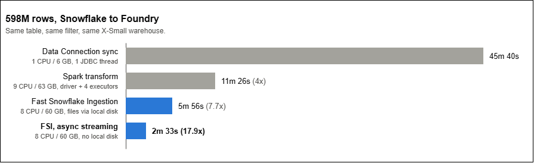

# From Snowflake to Foundry in minutes, not hours. Meet our Fast Snowflake Ingestion library

`FastSnowflakeIngestion` (FSI) is a small Python library Nicolas Renkamp and I have written which syncs data from Snowflake into Palantir Foundry from inside a single Lightweight container. In a head-to-head test on 598M rows (X-Small warehouse) it was **17.9x faster than a Data Connection sync** and **2x faster than a Spark transform** with the same compute, but it can be even faster. It is now part of Merck Group's open-source [foundry-dev-tools library](https://github.com/emdgroup/foundry-dev-tools/blob/main/docs/examples/fast-snowflake-ingestion.md).

**EDIT (26 November 2026):** we have tested a new **streaming mode** on the same 598M-row benchmark: **2m 33s, roughly 18x faster** than the Data Connection sync and 2.3x faster than the current FSI. It is not released yet - it is in review ([PR #125](https://github.com/emdgroup/foundry-dev-tools/pull/125)) and will come with the **next foundry-dev-tools release**. Details in [the benchmark](#benchmark-a-598m-row-head-to-head) below. The log line of the test run:

`INFO  [2026-11-26T13:09:02.391106855Z] transforms-container-ops: foundry_dev_tools.helpers.fast_snowflake_ingestion._impl - INFO - FSI run completed in 113.8 s (streaming=True): 23993.8 MB uploaded at 210.9 MB/s, 598134690 rows at 5256723 rows/s`

At Merck we are leveraging this library to ingest the data from Snowflake to Foundry at a large scale already.

## Getting Snowflake data into Foundry

Foundry offers an out-of-the-box way to ingest data from Snowflake via a Snowflake Data Source, and a more tunable in-code approach thanks to `TableInput` and the whole `Table` class family. That gives you three options:

- **Data Connection sync.** Configured in the UI with a SQL query against the source. The sync runs as a single JDBC process with one fetch thread, so it cannot scale out.
- **Spark transform.** A `TableInput` being a Virtual table used in a Spark transform. This gives you more freedom in terms of tuning (Spark profiles) and transformation (the [Spark Snowflake connector](https://github.com/snowflakedb/spark-snowflake) pushes filters and other operations down to Snowflake). It works, but it's still Spark that ingests, and Spark is not always the best choice due to its size.
- **Lightweight transform.** Similar to the Spark transform, but your code runs on a single node that you can scale up as needed, at a low cost. With a Snowpark session, transformations can be pushed down to Snowflake. Combining the `Table` classes with custom logic, you can basically write your own sync.

Since Foundry can talk to Snowflake programmatically, we thought there must be a more efficient way to get the same data. FSI is our answer to the third option.

## How it works

You shape the data in Snowpark - filters, casts, column selection - and then make one call. The library does the rest in four steps:

1. **Unload inside Snowflake.** `COPY INTO` writes the Snowpark DataFrame to Parquet files in a temporary stage. Snowflake does the heavy lifting where the data already lives.
2. **Download** the files to the Foundry container.
3. **Upload in parallel** to the output dataset, using a thread pool sized to the provisioned CPUs.
4. **Commit** the dataset transaction.

**Coming in the next release: streaming.** Steps 2 and 3 merge into one. The temporary stage is created with server-side encryption (`SNOWFLAKE_SSE`), so each Parquet file can be read through a short-lived presigned URL. FSI streams every file straight into the output as soon as `COPY INTO` has written it, while the unload is still running, and the local disk is not used at all. It becomes the default; roles that cannot create a stage fall back to the current download path.

It is that straightforward, although there is a lot to tune if one wants to. It runs in Foundry **Lightweight** transforms: one small container, no Spark cluster, no executors to pay for. On top of that you get to choose how many resources should be used and how the data should be shaped upon ingestion so it fits any pipeline's requirements.

A minimal script that just ingests a Snowflake table to Foundry (with no additional transformations, from a shared database) looks like this. **With the released version 2.1.26 it runs the download-to-disk approach** (steps 1-4 above):
```python
# foundry-dev-tools 2.1.26: COPY INTO -> download to local disk -> parallel upload -> commit
from foundry_dev_tools.helpers.fast_snowflake_ingestion import FastSnowflakeIngestion
from transforms.api import Output, transform
from transforms.tables import TableInput


@transform.lightweight(
    out=Output("/path/to/output_dataset"),
    virtual_table=TableInput("/path/to/snowflake_virtual_table"),
).with_resources(cpu_cores=2, memory_gb=15)
def sync(out, virtual_table):
    fsi = FastSnowflakeIngestion(
        snowpark_session=virtual_table.snowpark().session,
        output=out,
        provisioned_vcpus=2,
        # The database is needed for a temporary stage creation only
        use_shared_db=True,
        db_name="MY_DATABASE",
        schema_name="MY_SCHEMA",
    )

    fsi.save_snowpark_dataframe_to_foundry_output(
        virtual_table.snowpark().dataframe()
    )
```

**With the next release, the same code streams** - no change needed: streaming becomes the default, and the temporary stage in `MY_DATABASE.MY_SCHEMA` is then created with `SNOWFLAKE_SSE` encryption. To keep the download-to-disk approach, pass `enable_streaming=False`.

It ships as part of the open-source [foundry-dev-tools](https://github.com/emdgroup/foundry-dev-tools) (from version 2.1.26): `pip install foundry-dev-tools snowflake-snowpark-python`.

File size, compression and upload parallelism are all configurable, but the defaults cover most tables.

## Benchmark: a 598M-row head-to-head

To compare the methods under equal conditions, we synced the same table from the same Snowflake source (TPCH_SF100.LINEITEM), with the same filter (`L_COMMITDATE >= '1992-03-01'`, dropping ~0.3% of the ~600M rows), into Foundry - four times, the last one with the streaming mode from the next release:

| Method | Compute on the Foundry side | Duration | Speedup |
|---|---|---|---|
| Data Connection sync | 1 CPU (driver only), 6 GB RAM, 1 fetch thread | 45m 40s | 1x |
| Spark transform | 9 CPU / 63 GB (driver + 4 executors, 2 CPUs each) | 11m 26s | 4x |
| **Fast Snowflake Ingestion** (2.1.26, files via local disk) | 8 CPU / 60 GB, one Lightweight container | **5m 56s** | **7.7x** |
| **Fast Snowflake Ingestion, streaming** (next release) | 8 CPU / 60 GB, one Lightweight container, no local disk | **2m 33s** | **17.9x** |



All four produced exactly **598,134,690** rows and 21-24 GB of Parquet, all reading through the same **X-Small** Snowflake warehouse.



With roughly the same compute, the library is about **2x faster than Spark** today and **4.5x faster with streaming**, without a cluster. The Data Connection sync cannot be scaled the same way, because it fetches the whole result on one thread.

In our streaming tests, `COPY INTO` itself took about 100 seconds and the files were streamed while it was running, with only a few seconds of transfer left once it finished: the X-Small warehouse is now the bottleneck, not the transfer.

## Why the other methods are slower

- **Data Connection sync** reads through a JDBC connector on a single CPU (Spark with one driver). Every row travels over one connection, a few thousand rows per fetch, and the Parquet files are written one after another. More hardware does not help, because there is nothing to parallelise.
- **Spark transform** has to pull the result in many small Arrow chunks from object storage. You can observe it in the output dataset. In our case it is 569 files averaging ~42 MB, compared to 137 files of ~171 MB from FSI.
- **FSI** lets Snowflake do the export in bulk (`COPY INTO`) and only moves finished Parquet files, in parallel across all provisioned CPUs.

With FSI, the files are already sized for downstream needs. Instead of hundreds of small files, the newly ingested files can be tuned to the optimal size.

## Observability

Every Snowflake session the library opens carries a JSON query tag: the Foundry output dataset, job, branch, transaction, and the exact repository file and commit that ran it. That means every Snowflake credit can be traced back to one Foundry dataset and one line of code.

We now use those tags to measure the cost of each ingestion to a job level.

The library also writes the Snowflake session ID into each output dataset (as the name of an empty text file), so going from a failed build to the matching Snowflake queries takes minutes instead of a round of support tickets.

## Limitations (or advantages)

- No built-in incremental syncs yet - every run is a full or filtered export. This could be implemented with additional custom logic though (`@incremental` + `out.set_mode("previous")` shenanigans).
- In the current release (2.1.26) all files are downloaded to the container's local disk before upload, so make sure the attached disk can handle it. It usually is large enough by default. The next release removes this: our earlier streaming attempt only got encrypted bytes because the default stage is client-side encrypted, and a stage with server-side encryption (`SNOWFLAKE_SSE`) serves plain Parquet via presigned URLs.
- It runs only inside Foundry Lightweight transforms.

## What's next
Using the same paradigms we also accelerate our Foundry to Snowflake exports. We are thinking about publishing this code as well.

If you are moving data between Snowflake and Foundry, give it a try and let us know how it goes.

#Snowflake #Palantir #Foundry #Python #OpenSource #Sync #FoundryDevTools
